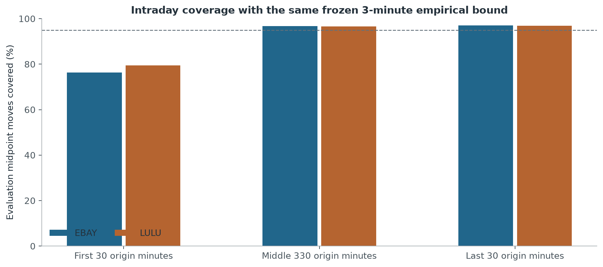

# Market Making Lab

A small Python study of inventory, quote delay and stock price risk. The simulation tracks cash and inventory, then compares quoting rules on the same market paths. A separate stock exercise checks whether bounds calibrated on earlier data cover later price moves.

The main findings:

- **Inventory control reduced drawdown.** In balanced simulated flow, the AS-inspired inventory rule reduced mean maximum drawdown from 85.45 to 39.14 model units. Its profit difference against a rule with the same spread was small and uncertain: +0.89, with a paired 95% interval of −5.18 to +7.02.
- **Wider quotes traded protection for activity.** With 75% informed customers and a three-event delay, a fixed buffer changed mean net P&L from −114.11 to −4.27, while fills fell from 96.32 to 31.80. The wider rule still lost money.
- **Whole-session coverage hid opening risk.** A fixed empirical bound covered about 95% of later three-minute moves in EBAY and LULU, but only 76-80% for moves starting in the opening half-hour.



Start with the five-event ledger example. Python 3.10+ is enough; calculations and tests use only the standard library. Run from the repository root:

```bash
python3 study/lesson.py
PYTHONPATH=study python3 -m unittest discover -s tests -q
```

Code is in `study/`; checks are in `tests/`. [Study notes](docs/STUDY.md) explain the comparisons, limits and commands for reproducing each experiment. Saved tables cover [inventory](results/inventory/summary.csv), [delay](results/delay/summary.csv) and [stocks](results/stock/summary.csv). The [data guide](data/README.md) lists stock inputs and checksums; raw prices are not bundled.

Synthetic P&L includes fees and terminal liquidation. There are no queues, partial fills or market impact. The stock exercise measures price coverage, not fills or trading profit, and its data were used before this study.

[Result provenance](results/provenance.json) identifies the original runs. The [version before simplification](https://github.com/Wanji-Jimmy/market-making-lab/tree/archive/before-2026-10-26-simplification), [earlier public version](https://github.com/Wanji-Jimmy/market-making-lab/tree/archive/before-2026-10-26-update) and [extended study](https://github.com/Wanji-Jimmy/market-making-lab/tree/extended-study) preserve the older work.
