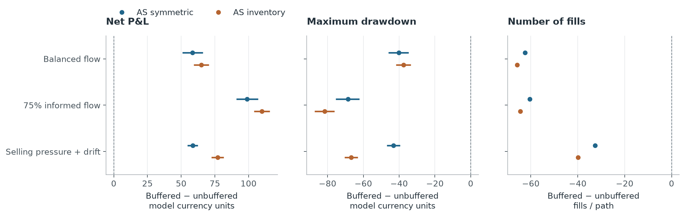

# Study notes

## 1. Follow the ledger, then compare inventory rules

[lesson.py](../study/lesson.py) passes five events to `simulate()` in [simulator.py](../study/simulator.py). Buying one unit reduces cash and increases inventory; selling reverses both. Marked wealth is cash plus inventory times the current reference price.

Profit equals execution edge plus inventory price-change P&L, less trading fees. Closing the final inventory has a separate cost. The example's execution edge is +2.70 and inventory P&L is −6.00: marked P&L is −3.30, falling to −4.30 after liquidation.

[research.py](../study/research.py) compares four quoting rules across eight environments, with 500 independent market paths per environment and 300 events per path. Each rule faces the same paths and seeds. Five separate random-number streams prevent a customer draw from changing the reference-price path. Reusing a path creates a paired comparison; it does not create another independent market history.

With equally wide AS-inspired quotes in balanced flow, inventory shifting reduced mean maximum drawdown from 85.45 to 39.14 model units. The mean profit difference was +0.89, with a paired 95% interval of −5.18 to +7.02; a profit improvement is not established. Tables: [summary](../results/inventory/summary.csv), [paired comparisons](../results/inventory/paired.csv), [markouts](../results/inventory/markouts.csv).

Profit includes trading fees and terminal liquidation. Risk measures use marked wealth before liquidation. The [protocol](../study/research_protocol.json) records seeds, parameters and comparisons. The AS-inspired rules shift the price around which they quote according to inventory and use a prescribed width. They are simplified controls, not a fitted or optimal implementation of [Avellaneda and Stoikov's model](https://math.nyu.edu/inmemoriam/avellaneda/HighFrequencyTrading.pdf).

## 2. Add delayed replacement

[latency_simulator.py](../study/latency_simulator.py) holds one live unit on each side, with fixed prices and identifiers for each quote generation. A replacement arrives after a set number of events. The old quote can fill while replacement is pending; a filled side cannot fill again until a replacement arrives.

[latency_research.py](../study/latency_research.py) compares six rules across three environments, delays of 0/1/3 events and 500 shared paths per environment. The added half-width is fixed at `sigma * sqrt(delay)`; it was not fitted to improve these outcomes. See the [protocol](../study/latency_protocol.json) and saved [summary](../results/delay/summary.csv), [paired comparisons](../results/delay/paired.csv) and [markouts](../results/delay/markouts.csv).

Informed customers receive a noisy signal of the next simulated price change. With 75% informed customers, the AS-inspired inventory rule's mean net P&L changes from +8.88 with immediate replacement to −114.11 with a three-event delay. Adding the buffer improves the paired result by +109.84 model units, with a pointwise paired 95% interval of [103.93, 115.78]. Mean P&L remains negative at −4.27, while fills fall from 96.32 to 31.80.



Both sides are replaced together; the initial pair is already live. Requests and, after startup, replacements occur every event. Delay is not an extra wait after each fill, and event counts are not measured milliseconds. Cash and inventory limits can veto a fill immediately, an idealisation that can overstate control of pending orders. Queues, competing orders, partial fills, feed latency, market impact and exchange risk reservation are absent.

[hftbacktest's latency documentation](https://hftbacktest.readthedocs.io/en/latest/latency_models.html) and [ABIDES](https://arxiv.org/abs/1904.12066) informed the order-state questions; their engines are not used here.

## 3. Check price bounds with stock quotes

[equity_research.py](../study/equity_research.py) uses minute-end national best bid and offer (NBBO) midpoints for EBAY and LULU. Each stock has 40 sessions from 4 January to 2 March 2021. The first 20 calibrate the bounds; the next 20 evaluate them. These data were already used elsewhere, so this is not a blind test.

For horizons of 1, 3 and 10 minutes, the study compares three fixed bounds: one standard deviation scaled by the square root of time, a Gaussian 95% reference, and the training absolute-return 95th percentile. The first has no 95% coverage target. No threshold is refitted to the evaluation or opening-period results. The [stock protocol](../study/equity_protocol.json) fixes these choices.

[equity_data.py](../study/equity_data.py) keeps 390 regular-session minute starts, from 09:30 inclusive to 16:00 exclusive in New York time. The 16:00 bar and overnight windows are excluded. Every minute in a return window must have valid quotes. Equal bid and ask prices remain valid; crossed or invalid quotes are excluded. Zero quote updates need not mean a missing observation. Missing minutes are not interpolated, and windows stay within one session and phase.

At three minutes, the empirical bound covers 95.13% of EBAY and 95.23% of LULU evaluation windows. For moves starting in the opening half-hour, coverage falls to 76.33% and 79.50%, versus 96.68% and 96.53% in the middle 330 minutes. A whole-session threshold can hide opening risk. This split is descriptive; it is not a fitted opening strategy or a test of differences between periods.

The saved [summary](../results/stock/summary.csv), [time bands](../results/stock/session_segments.csv) and [quote endpoints](../results/stock/endpoint_quotes.csv) retain all 18 aggregate results, 54 time-band results and six endpoint comparisons. [Calibration](../results/stock/calibration.csv) and [daily counts](../results/stock/daily.csv) are also available. Whole-session 95% intervals use 2,000 shared bootstrap draws of five consecutive trading sessions, without wrapping the last session back to the first. Windows overlap and only 20 evaluation sessions per stock are available. Intervals hold calibration fixed, exclude its uncertainty and make no adjustment for multiple comparisons.

Endpoint comparisons ask whether an earlier quote lies beyond a later midpoint or opposite quote. They do not establish our own resting orders or fills. An unchanged equal bid and ask can satisfy both inclusive touch comparisons without a price move. Minute snapshots cannot translate event delays into clock time or establish real maker profit.

## Run the studies

Use Python 3.10+ from the repository root. The [README](../README.md) has the ledger example and tests. These small checks also need no packages or downloaded data:

```bash
python3 study/research.py --output-dir /tmp/mm-inventory-check --runs 3 --steps 10 --paired-resamples 10 --markout-resamples 10
python3 study/latency_research.py --output-dir /tmp/mm-delay-check --runs 2 --steps 10 --paired-resamples 10 --markout-resamples 10
```

These check simulation, accounting and output writing. To reproduce the published estimates, use the full settings:

```bash
python3 study/research.py --output-dir /tmp/mm-inventory-full
python3 study/latency_research.py --output-dir /tmp/mm-delay-full
```

Choose an unused output directory. Each run records parameters, checks and hashes. The small inventory and delay runs are labelled `exploratory` and `smoke`, respectively.

For stocks, follow the [data guide](../data/README.md) for the command and exact 80 CSVs. Defaults resolve from this repository; explicit paths let raw files stay elsewhere. Changed vendor files fail checksum validation.

## Source history

The tables and two figures retain their original bytes; [provenance](../results/provenance.json) records producer hashes. Maintenance changed paths, messages, organisation and unused protocol metadata, without changing calculations or selecting new results.

The functions in [stock_statistics.py](../study/stock_statistics.py) were extracted unchanged from the crypto runner. The stock protocol's parent hashes identify the historical source and protocol. Fresh stock runs hash the current producer, helpers, protocol and tests before and after calculation, giving different source hashes and fingerprints. Original full manifests and large traces remain archived locally.

The [archive before simplification](https://github.com/Wanji-Jimmy/market-making-lab/tree/archive/before-2026-10-26-simplification) contains the crypto study and superseded inventory experiment. The [earlier public version](https://github.com/Wanji-Jimmy/market-making-lab/tree/archive/before-2026-10-26-update) and [extended study](https://github.com/Wanji-Jimmy/market-making-lab/tree/extended-study) also remain available.
